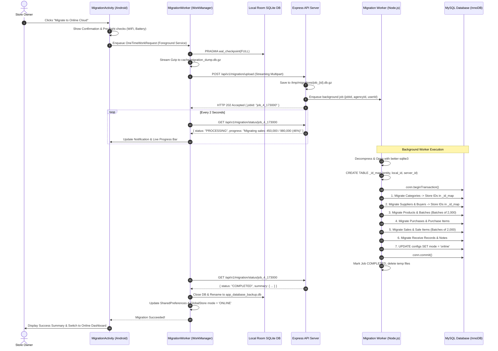

# Enterprise Offline-to-Online Migration Implementation Plan
## High-Scale Migration Architecture (Millions of Records)

---

## 1. Executive Summary & Architecture Overview

### 1.1 Objective
Enable a seamless, rock-solid migration of an entire offline business instance from an Android device (local SQLite Room database) to the centralized multi-tenant MySQL backend (`inventory_september`), transitioning the agency mode from `full offline` to `full online`. The system is designed to handle **millions of records** across 16 interrelated tables within minutes without causing memory crashes, request timeouts, or database lock starvation.

### 1.2 Core Architectural Principles
1. **Asynchronous Non-Blocking Execution**: Android uploads the compressed database snapshot; the backend immediately acknowledges with a `jobId`. The heavy migration runs in a detached background worker while the Android device polls for real-time progress.
2. **Zero-Memory Streaming (Constant O(1) RAM)**:
   * **Android**: Gzips the SQLite file using a streaming 8 KB buffer (`FileInputStream` &rarr; `GZIPOutputStream`).
   * **Backend**: Reads SQLite using compiled C++ iterators (`better-sqlite3` `.iterate()`) in batches of 2,000 rows. No multi-million record arrays in Node.js V8 heap.
3. **On-Disk ID Translation**: Primary/foreign key translation maps (`Map<oldLocalId, newServerId>`) are stored inside a temporary SQLite table (`_id_map`) on disk, consuming 0 MB of JavaScript RAM.
4. **Preservation of Pre-Calculated State**: No tax recalculations or inventory decrement loops are replayed on the server. The server acts as a high-speed ingestion engine for pre-calculated numbers, preserving historical ledger accuracy.
5. **Full Transactional Atomicity**: If any phase fails, MySQL rolls back completely, ensuring zero corrupt or orphaned records.

---

## 2. System Architecture & Flow



---

## 3. Database Schema Cross-Reference & Mapping Order

The migration must insert records in strict **Topological Dependency Order** to satisfy MySQL foreign key constraints:

| Stage | Entity / Table | Local SQLite Source | Target MySQL Table | Foreign Keys to Resolve via `_id_map` | Unique Business Deduplication Key |
| :--- | :--- | :--- | :--- | :--- | :--- |
| **1** | Categories | `categories` | `categories` | None | `(agency_id, category_name)` |
| **1** | Suppliers | `suppliers` | `suppliers` | None | `(agency_id, phone)` |
| **1** | Buyers | `buyers` | `buyers` | None | `(agency_id, phone)` or Name |
| **2** | Products | `products` | `products` | `category_id` &larr; `_id_map(category)` | `(agency_id, sku)` |
| **3** | Batches | `product_batches` | `product_batches` | `product_id` &larr; `_id_map(product)` | `(agency_id, product_id, batch_no)` |
| **3** | Purchases | `purchases` | `purchases` | `supplier_id` &larr; `_id_map(supplier)` | `(agency_id, invoice_id)` |
| **4** | Purchase Items | `purchase_items` | `purchase_items` | `purchase_id`, `product_id` | Auto-increment PK |
| **4** | Sales | `sales` | `sales` | `buyer_id` &larr; `_id_map(buyer)` | `(agency_id, invoice_id)` |
| **5** | Sale Items | `sale_items` | `sale_items` | `sale_id`, `product_id`, `batch_id` | Auto-increment PK |
| **5** | Receive Records | `receive_records` | `receive_records` | `purchase_id` | Auto-increment PK |
| **6** | Receive Items | `receive_items` | `receive_items` | `receive_record_id`, `purchase_item_id`, `product_id`, `batch_id` | Auto-increment PK |
| **6** | Credit/Debit Notes| `credit_debit_notes` | `credit_debit_notes`| `buyer_id` | `(agency_id, note_number)` |
| **7** | Audit Trails | `audit_trails` | `audit_trails` | None (Direct insert) | Auto-increment PK |
| **8** | Config Mode | `configs` | `configs` | None | `(agency_id, 'mode')` &rarr; `'online'` |

---

## 4. Backend Implementation Plan (`E:\workspace\Inventory_September\backend`)

### 4.1 Required Dependencies
Run in `E:\workspace\Inventory_September\backend`:
```bash
npm install better-sqlite3 multer
npm install --save-dev @types/better-sqlite3 @types/multer
```

### 4.2 File Structure Updates
```
backend/
├── src/
│   ├── controllers/
│   │   └── migration.controller.ts       <-- Handles upload & status polling
│   ├── routes/
│   │   └── migration.routes.ts           <-- Dedicated routes (bypassing rate limiter)
│   ├── services/
│   │   └── migrationWorker.service.ts    <-- Core streaming worker engine
│   └── index.ts                          <-- Mounts migration routes
```

### 4.3 Migration Worker Service Implementation
**File**: `src/services/migrationWorker.service.ts`

```typescript
import Database from "better-sqlite3";
import fs from "fs";
import zlib from "zlib";
import { poolPromise } from "../utils/dbConnect";

export interface MigrationJobState {
    jobId: string;
    agencyId: number;
    userId: number;
    status: "PROCESSING" | "COMPLETED" | "FAILED";
    progress: string;
    totalRecordsMigrated: number;
    error?: string;
    startTime: number;
    endTime?: number;
}

export const activeMigrationJobs = new Map<string, MigrationJobState>();

export async function processMigrationJob(
    jobId: string,
    gzFilePath: string,
    agencyId: number,
    userId: number
): Promise<void> {
    const job = activeMigrationJobs.get(jobId);
    if (!job) return;

    const decompressedDbPath = `${gzFilePath}.db`;

    try {
        // --- STEP 1: STREAM DECOMPRESS GZIP ---
        job.progress = "Decompressing database dump...";
        const readStream = fs.createReadStream(gzFilePath);
        const writeStream = fs.createWriteStream(decompressedDbPath);
        await new Promise((resolve, reject) => {
            readStream.pipe(zlib.createGunzip()).pipe(writeStream)
                .on("finish", resolve)
                .on("error", reject);
        });

        // --- STEP 2: OPEN SQLITE WITH OPTIMIZED PRAGMAS ---
        const sqlite = new Database(decompressedDbPath, { readonly: false });
        sqlite.pragma("journal_mode = OFF");
        sqlite.pragma("synchronous = 0");
        sqlite.pragma("cache_size = -64000"); // 64MB cache

        // Create on-disk ID translation table
        sqlite.exec(`
            CREATE TABLE IF NOT EXISTS _id_map (
                entity TEXT NOT NULL,
                local_id INTEGER NOT NULL,
                server_id INTEGER NOT NULL,
                PRIMARY KEY (entity, local_id)
            );
        `);
        const insertMapStmt = sqlite.prepare("INSERT INTO _id_map VALUES (?, ?, ?)");

        const pool = await poolPromise;
        const conn = await pool.getConnection();

        try {
            await conn.beginTransaction();

            // --- STEP 3: MASTER DATA (Categories, Suppliers, Buyers) ---
            job.progress = "Migrating categories...";
            for (const cat of sqlite.prepare("SELECT * FROM categories").iterate() as any) {
                const [existing]: any = await conn.execute(
                    "SELECT category_id FROM categories WHERE agency_id = ? AND category_name = ?",
                    [agencyId, cat.category_name]
                );
                if (existing.length > 0) {
                    insertMapStmt.run("category", cat.category_id, existing[0].category_id);
                } else {
                    const [res]: any = await conn.execute(
                        "INSERT INTO categories (agency_id, category_name, description, icon, is_active) VALUES (?, ?, ?, ?, 1)",
                        [agencyId, cat.category_name, cat.description || null, cat.icon || "general"]
                    );
                    insertMapStmt.run("category", cat.category_id, res.insertId);
                }
            }

            job.progress = "Migrating suppliers...";
            for (const sup of sqlite.prepare("SELECT * FROM suppliers").iterate() as any) {
                const [res]: any = await conn.execute(
                    `INSERT INTO suppliers (agency_id, supplier_name, contact_person, phone, email, address, city, state_code, postal_code, gst, is_active)
                     VALUES (?, ?, ?, ?, ?, ?, ?, ?, ?, ?, 1)
                     ON DUPLICATE KEY UPDATE supplier_name = VALUES(supplier_name)`,
                    [agencyId, sup.supplier_name, sup.contact_person, sup.phone, sup.email, sup.address, sup.city, sup.state_code, sup.postal_code, sup.gst]
                );
                const actualId = res.insertId || (await conn.execute("SELECT supplier_id FROM suppliers WHERE agency_id = ? AND phone = ?", [agencyId, sup.phone]))[0][0].supplier_id;
                insertMapStmt.run("supplier", sup.supplier_id, actualId);
            }

            job.progress = "Migrating buyers...";
            for (const buy of sqlite.prepare("SELECT * FROM buyers").iterate() as any) {
                const [res]: any = await conn.execute(
                    `INSERT INTO buyers (agency_id, buyer_name, contact_person, phone, email, address, city, state_code, billing_state_code, gst, is_active)
                     VALUES (?, ?, ?, ?, ?, ?, ?, ?, ?, ?, 1)`,
                    [agencyId, buy.buyer_name, buy.contact_person, buy.phone, buy.email, buy.address, buy.city, buy.state_code, buy.billing_state_code, buy.gst]
                );
                insertMapStmt.run("buyer", buy.buyer_id, res.insertId);
            }

            // --- STEP 4: PRODUCTS (Stream in chunks of 2,000) ---
            job.progress = "Migrating products (streaming)...";
            const productQuery = `
                SELECT p.*, m.server_id AS mapped_cat_id
                FROM products p
                LEFT JOIN _id_map m ON m.entity = 'category' AND m.local_id = p.category_id
            `;
            let prodBatch: any[][] = [];
            let prodLocalIds: number[] = [];

            for (const p of sqlite.prepare(productQuery).iterate() as any) {
                prodBatch.push([
                    agencyId, p.mapped_cat_id, p.product_name, p.sku, p.description, p.brand,
                    p.unit_of_measure, p.reorder_level, p.reorder_quantity, p.status, p.hsn_code,
                    p.gst_percent, p.gst_category, p.uqc || "PCS", p.cess_percent || 0,
                    p.default_markup_percent || 0, p.unit_price || 0, p.selling_price || 0,
                    p.quantity || 0, p.batch_enabled ? 1 : 0
                ]);
                prodLocalIds.push(p.product_id);

                if (prodBatch.length >= 2000) {
                    const [res]: any = await conn.query(
                        `INSERT INTO products (
                            agency_id, category_id, product_name, sku, description, brand,
                            unit_of_measure, reorder_level, reorder_quantity, status, hsn_code,
                            gst_percent, gst_category, uqc, cess_percent, default_markup_percent,
                            unit_price, selling_price, quantity, batch_enabled
                        ) VALUES ?`,
                        [prodBatch]
                    );
                    for (let i = 0; i < prodLocalIds.length; i++) {
                        insertMapStmt.run("product", prodLocalIds[i], res.insertId + i);
                    }
                    prodBatch = [];
                    prodLocalIds = [];
                }
            }
            if (prodBatch.length > 0) {
                const [res]: any = await conn.query(
                    `INSERT INTO products (
                        agency_id, category_id, product_name, sku, description, brand,
                        unit_of_measure, reorder_level, reorder_quantity, status, hsn_code,
                        gst_percent, gst_category, uqc, cess_percent, default_markup_percent,
                        unit_price, selling_price, quantity, batch_enabled
                    ) VALUES ?`,
                    [prodBatch]
                );
                for (let i = 0; i < prodLocalIds.length; i++) {
                    insertMapStmt.run("product", prodLocalIds[i], res.insertId + i);
                }
            }

            // --- STEP 5: PRODUCT BATCHES ---
            job.progress = "Migrating product batches...";
            const batchQuery = `
                SELECT pb.*, pm.server_id AS mapped_prod_id
                FROM product_batches pb
                JOIN _id_map pm ON pm.entity = 'product' AND pm.local_id = pb.product_id
            `;
            let batchRows: any[][] = [];
            let batchLocalIds: number[] = [];

            for (const b of sqlite.prepare(batchQuery).iterate() as any) {
                batchRows.push([
                    agencyId, b.mapped_prod_id, b.batch_no, b.quantity, b.purchase_price,
                    b.selling_price, b.expiry_date, b.status || "ACTIVE"
                ]);
                batchLocalIds.push(b.batch_id);

                if (batchRows.length >= 2000) {
                    const [res]: any = await conn.query(
                        `INSERT INTO product_batches (agency_id, product_id, batch_no, quantity, purchase_price, selling_price, expiry_date, status) VALUES ?`,
                        [batchRows]
                    );
                    for (let i = 0; i < batchLocalIds.length; i++) {
                        insertMapStmt.run("batch", batchLocalIds[i], res.insertId + i);
                    }
                    batchRows = [];
                    batchLocalIds = [];
                }
            }
            if (batchRows.length > 0) {
                const [res]: any = await conn.query(
                    `INSERT INTO product_batches (agency_id, product_id, batch_no, quantity, purchase_price, selling_price, expiry_date, status) VALUES ?`,
                    [batchRows]
                );
                for (let i = 0; i < batchLocalIds.length; i++) {
                    insertMapStmt.run("batch", batchLocalIds[i], res.insertId + i);
                }
            }

            // --- STEP 6: PURCHASES & PURCHASE ITEMS ---
            job.progress = "Migrating purchases and purchase items...";
            const purQuery = `
                SELECT pu.*, sm.server_id AS mapped_sup_id
                FROM purchases pu
                LEFT JOIN _id_map sm ON sm.entity = 'supplier' AND sm.local_id = pu.supplier_id
            `;
            for (const pu of sqlite.prepare(purQuery).iterate() as any) {
                const [res]: any = await conn.execute(
                    `INSERT INTO purchases (
                        agency_id, supplier_id, invoice_id, purchase_date, subtotal_amount,
                        cgst_amount, sgst_amount, igst_amount, total_gst, other_charges,
                        total_amount, discount_amount, discount_percent, status, created_by
                    ) VALUES (?, ?, ?, ?, ?, ?, ?, ?, ?, ?, ?, ?, ?, ?, ?)`,
                    [
                        agencyId, pu.mapped_sup_id, pu.invoice_id, pu.purchase_date, pu.subtotal_amount,
                        pu.cgst_amount, pu.sgst_amount, pu.igst_amount, pu.total_gst, pu.other_charges,
                        pu.total_amount, pu.discount_amount, pu.discount_percent, pu.status, userId
                    ]
                );
                insertMapStmt.run("purchase", pu.purchase_id, res.insertId);
            }

            const purItemQuery = `
                SELECT pi.*, pum.server_id AS mapped_pur_id, pm.server_id AS mapped_prod_id
                FROM purchase_items pi
                JOIN _id_map pum ON pum.entity = 'purchase' AND pum.local_id = pi.purchase_id
                JOIN _id_map pm ON pm.entity = 'product' AND pm.local_id = pi.product_id
            `;
            let purItemBatch: any[][] = [];
            let purItemLocalIds: number[] = [];

            for (const pi of sqlite.prepare(purItemQuery).iterate() as any) {
                purItemBatch.push([
                    agencyId, pi.mapped_pur_id, pi.mapped_prod_id, pi.quantity, pi.unit_price,
                    pi.cgst_rate, pi.sgst_rate, pi.igst_rate, pi.cgst_amount, pi.sgst_amount,
                    pi.igst_amount, pi.total_tax, pi.subtotal, pi.total_amount
                ]);
                purItemLocalIds.push(pi.purchase_item_id);

                if (purItemBatch.length >= 2000) {
                    const [res]: any = await conn.query(
                        `INSERT INTO purchase_items (
                            agency_id, purchase_id, product_id, quantity, unit_price,
                            cgst_rate, sgst_rate, igst_rate, cgst_amount, sgst_amount,
                            igst_amount, total_tax, subtotal, total_amount
                        ) VALUES ?`,
                        [purItemBatch]
                    );
                    for (let i = 0; i < purItemLocalIds.length; i++) {
                        insertMapStmt.run("purchase_item", purItemLocalIds[i], res.insertId + i);
                    }
                    purItemBatch = [];
                    purItemLocalIds = [];
                }
            }
            if (purItemBatch.length > 0) {
                const [res]: any = await conn.query(
                    `INSERT INTO purchase_items (
                        agency_id, purchase_id, product_id, quantity, unit_price,
                        cgst_rate, sgst_rate, igst_rate, cgst_amount, sgst_amount,
                        igst_amount, total_tax, subtotal, total_amount
                    ) VALUES ?`,
                    [purItemBatch]
                );
                for (let i = 0; i < purItemLocalIds.length; i++) {
                    insertMapStmt.run("purchase_item", purItemLocalIds[i], res.insertId + i);
                }
            }

            // --- STEP 7: SALES (Stream in chunks of 2,000) ---
            job.progress = "Migrating sales invoices...";
            const saleQuery = `
                SELECT s.*, bm.server_id AS mapped_buyer_id
                FROM sales s
                LEFT JOIN _id_map bm ON bm.entity = 'buyer' AND bm.local_id = s.buyer_id
            `;
            let saleBatch: any[][] = [];
            let saleLocalIds: number[] = [];

            for (const s of sqlite.prepare(saleQuery).iterate() as any) {
                saleBatch.push([
                    agencyId, s.mapped_buyer_id, s.customer_name, s.customer_phone, s.customer_gstin,
                    s.is_walk_in ? 1 : 0, s.place_of_supply, s.place_of_supply_state_code, s.invoice_id,
                    s.subtotal_amount, s.cgst_amount, s.sgst_amount, s.igst_amount, s.total_gst,
                    s.cess_amount, s.other_charges, s.total_amount, s.discount_amount, s.discount_percent,
                    s.payment_method, s.status, userId, s.billing_date
                ]);
                saleLocalIds.push(s.sale_id);

                if (saleBatch.length >= 2000) {
                    const [res]: any = await conn.query(
                        `INSERT INTO sales (
                            agency_id, buyer_id, customer_name, customer_phone, customer_gstin,
                            is_walk_in, place_of_supply, place_of_supply_state_code, invoice_id,
                            subtotal_amount, cgst_amount, sgst_amount, igst_amount, total_gst,
                            cess_amount, other_charges, total_amount, discount_amount, discount_percent,
                            payment_method, status, created_by, billing_date
                        ) VALUES ?`,
                        [saleBatch]
                    );
                    for (let i = 0; i < saleLocalIds.length; i++) {
                        insertMapStmt.run("sale", saleLocalIds[i], res.insertId + i);
                    }
                    saleBatch = [];
                    saleLocalIds = [];
                }
            }
            if (saleBatch.length > 0) {
                const [res]: any = await conn.query(
                    `INSERT INTO sales (
                        agency_id, buyer_id, customer_name, customer_phone, customer_gstin,
                        is_walk_in, place_of_supply, place_of_supply_state_code, invoice_id,
                        subtotal_amount, cgst_amount, sgst_amount, igst_amount, total_gst,
                        cess_amount, other_charges, total_amount, discount_amount, discount_percent,
                        payment_method, status, created_by, billing_date
                    ) VALUES ?`,
                    [saleBatch]
                );
                for (let i = 0; i < saleLocalIds.length; i++) {
                    insertMapStmt.run("sale", saleLocalIds[i], res.insertId + i);
                }
            }

            // --- STEP 8: SALE ITEMS (Joined directly with on-disk _id_map) ---
            job.progress = "Migrating sale line items (high speed streaming)...";
            const saleItemsQuery = `
                SELECT 
                    si.*,
                    sm.server_id AS mapped_sale_id,
                    pm.server_id AS mapped_prod_id,
                    bm.server_id AS mapped_batch_id
                FROM sale_items si
                JOIN _id_map sm ON sm.entity = 'sale' AND sm.local_id = si.sale_id
                JOIN _id_map pm ON pm.entity = 'product' AND pm.local_id = si.product_id
                LEFT JOIN _id_map bm ON bm.entity = 'batch' AND bm.local_id = si.batch_id
            `;
            let saleItemBatch: any[][] = [];

            for (const si of sqlite.prepare(saleItemsQuery).iterate() as any) {
                saleItemBatch.push([
                    agencyId, si.mapped_sale_id, si.mapped_prod_id, si.mapped_batch_id,
                    si.quantity, si.unit_price, si.selling_price, si.hsn_code, si.sac_code,
                    si.uqc || "PCS", si.gst_rate, si.cgst_rate, si.sgst_rate, si.igst_rate,
                    si.cess_rate, si.taxable_value, si.cgst_amount, si.sgst_amount, si.igst_amount,
                    si.cess_amount, si.subtotal, si.discount_percent, si.discount_amount
                ]);

                if (saleItemBatch.length >= 3000) {
                    await conn.query(
                        `INSERT INTO sale_items (
                            agency_id, sale_id, product_id, batch_id, quantity, unit_price,
                            selling_price, hsn_code, sac_code, uqc, gst_rate, cgst_rate,
                            sgst_rate, igst_rate, cess_rate, taxable_value, cgst_amount,
                            sgst_amount, igst_amount, cess_amount, subtotal, discount_percent,
                            discount_amount
                        ) VALUES ?`,
                        [saleItemBatch]
                    );
                    saleItemBatch = [];
                }
            }
            if (saleItemBatch.length > 0) {
                await conn.query(
                    `INSERT INTO sale_items (
                        agency_id, sale_id, product_id, batch_id, quantity, unit_price,
                        selling_price, hsn_code, sac_code, uqc, gst_rate, cgst_rate,
                        sgst_rate, igst_rate, cess_rate, taxable_value, cgst_amount,
                        sgst_amount, igst_amount, cess_amount, subtotal, discount_percent,
                        discount_amount
                    ) VALUES ?`,
                    [saleItemBatch]
                );
            }

            // --- STEP 9: UPDATE AGENCY CONFIG TO ONLINE MODE ---
            job.progress = "Switching agency mode to online...";
            await conn.execute(
                `INSERT INTO configs (agency_id, config_key, config_value)
                 VALUES (?, 'mode', 'online')
                 ON DUPLICATE KEY UPDATE config_value = 'online'`,
                [agencyId]
            );

            // --- COMMIT TRANSACTION ---
            await conn.commit();
            conn.release();
            sqlite.close();

            job.status = "COMPLETED";
            job.progress = "Migration completed successfully!";
            job.endTime = Date.now();

        } catch (txErr: any) {
            await conn.rollback();
            conn.release();
            sqlite.close();
            throw txErr;
        }

    } catch (err: any) {
        job.status = "FAILED";
        job.error = err.message;
        job.endTime = Date.now();
    } finally {
        // Clean up temporary disk files
        if (fs.existsSync(gzFilePath)) fs.unlinkSync(gzFilePath);
        if (fs.existsSync(decompressedDbPath)) fs.unlinkSync(decompressedDbPath);
    }
}
```

### 4.4 Controller & Routes
**File**: `src/controllers/migration.controller.ts`
```typescript
import { Request, Response } from "express";
import ApiResponse from "../utils/ApiResponse";
import ApiErrorResponse from "../utils/ApiErrorResponse";
import { activeMigrationJobs, processMigrationJob } from "../services/migrationWorker.service";

export const uploadAndStartMigration = async (req: Request, res: Response) => {
    const agencyId = req.user?.agency_id;
    const userId = req.user?.id;
    const file = req.file;

    if (!agencyId || !userId || !file) {
        return new ApiErrorResponse(400, null, "Agency ID and file required").send(res);
    }

    const jobId = `mig_${agencyId}_${Date.now()}`;
    activeMigrationJobs.set(jobId, {
        jobId,
        agencyId,
        userId,
        status: "PROCESSING",
        progress: "Upload received. Enqueued for migration.",
        totalRecordsMigrated: 0,
        startTime: Date.now()
    });

    // Run async in detached execution
    setImmediate(() => {
        processMigrationJob(jobId, file.path, agencyId, userId);
    });

    // Acknowledge immediately (202 Accepted)
    new ApiResponse(202, { jobId }, "Migration queued successfully").send(res);
};

export const getMigrationStatus = async (req: Request, res: Response) => {
    const { jobId } = req.params;
    const job = activeMigrationJobs.get(jobId);

    if (!job) {
        return new ApiErrorResponse(404, null, "Migration job not found").send(res);
    }

    new ApiResponse(200, job, "Status fetched").send(res);
};
```

**File**: `src/routes/migration.routes.ts`
```typescript
import { Router } from "express";
import multer from "multer";
import path from "path";
import fs from "fs";
import { uploadAndStartMigration, getMigrationStatus } from "../controllers/migration.controller";
import { verifyToken } from "../middlewares/auth.middleware";

const tempUploadDir = path.resolve(process.cwd(), "uploads/temp");
if (!fs.existsSync(tempUploadDir)) fs.mkdirSync(tempUploadDir, { recursive: true });

const upload = multer({
    dest: tempUploadDir,
    limits: { fileSize: 500 * 1024 * 1024 } // 500MB max limit
});

const router = Router();

router.post("/upload", verifyToken, upload.single("database"), uploadAndStartMigration);
router.get("/status/:jobId", verifyToken, getMigrationStatus);

export default router;
```

Mount in `src/index.ts` **above the rate limiter**:
```typescript
app.use("/api/v1/migration", require("./routes/migration.routes"));
```

---

## 5. Android Client Implementation Plan (`d:\Android\InventoryHub`)

### 5.1 Architecture Components
1. **`DatabaseCompressor.java`**: Flushes SQLite WAL and streams `.gz` compression with fixed 8 KB buffer.
2. **`MigrationWorker.java`** (AndroidX `WorkManager`): Executes upload and polling inside a Foreground Service with notification to prevent OS kill.
3. **`OnlineApiService.java`**: Adds Retrofit endpoints for upload and status polling.
4. **`MigrationActivity.java`**: Modern UI with confirmation dialog, progress bar, animated stats, and error recovery.

### 5.2 Streaming Database Compressor
**File**: `app/src/main/java/in/gbtsolutions/inventoryhub/migration/DatabaseCompressor.java`

```java
package in.gbtsolutions.inventoryhub.migration;

import android.content.Context;
import androidx.sqlite.db.SupportSQLiteDatabase;
import java.io.File;
import java.io.FileInputStream;
import java.io.FileOutputStream;
import java.io.IOException;
import java.util.zip.GZIPOutputStream;
import in.gbtsolutions.inventoryhub.Database;

public class DatabaseCompressor {

    public interface CompressionProgressListener {
        void onProgress(long bytesWritten, long totalBytes);
    }

    public static File createGzipSnapshot(Context context, CompressionProgressListener listener) throws IOException {
        Database db = Database.getInstance(context);

        // 1. Force full checkpoint so dirty WAL cache merges into app_database
        SupportSQLiteDatabase sqlDb = db.getOpenHelper().getWritableDatabase();
        sqlDb.query("PRAGMA wal_checkpoint(FULL)").close();

        File dbFile = context.getDatabasePath("app_database");
        long totalBytes = dbFile.length();

        File outputFile = new File(context.getCacheDir(), "offline_migration_dump.db.gz");
        if (outputFile.exists()) outputFile.delete();

        try (FileInputStream fis = new FileInputStream(dbFile);
             FileOutputStream fos = new FileOutputStream(outputFile);
             GZIPOutputStream gzos = new GZIPOutputStream(fos)) {

            byte[] buffer = new byte[8192];
            int read;
            long written = 0;

            while ((read = fis.read(buffer)) != -1) {
                gzos.write(buffer, 0, read);
                written += read;
                if (listener != null) {
                    listener.onProgress(written, totalBytes);
                }
            }
            gzos.finish();
        }

        return outputFile;
    }
}
```

### 5.3 Retrofit API Interface
Add to [OnlineApiService.java](file:///d:/Android/InventoryHub/app/src/main/java/in/gbtsolutions/inventoryhub/online/api/OnlineApiService.java):
```java
@Multipart
@POST("api/v1/migration/upload")
Call<ApiResponse<JsonObject>> uploadMigrationDump(
    @Part MultipartBody.Part database
);

@GET("api/v1/migration/status/{jobId}")
Call<ApiResponse<JsonObject>> getMigrationStatus(
    @Path("jobId") String jobId
);
```

### 5.4 Migration WorkManager Worker
**File**: `app/src/main/java/in/gbtsolutions/inventoryhub/migration/MigrationWorker.java`

```java
package in.gbtsolutions.inventoryhub.migration;

import android.app.Notification;
import android.app.NotificationChannel;
import android.app.NotificationManager;
import android.content.Context;
import android.content.SharedPreferences;
import android.os.Build;
import androidx.annotation.NonNull;
import androidx.core.app.NotificationCompat;
import androidx.work.ForegroundInfo;
import androidx.work.Worker;
import androidx.work.WorkerParameters;
import com.google.gson.JsonObject;
import java.io.File;
import in.gbtsolutions.inventoryhub.Configurations;
import in.gbtsolutions.inventoryhub.Database;
import in.gbtsolutions.inventoryhub.GlobalStore;
import in.gbtsolutions.inventoryhub.R;
import in.gbtsolutions.inventoryhub.helpers.Mode;
import in.gbtsolutions.inventoryhub.online.api.OnlineApiClient;
import in.gbtsolutions.inventoryhub.online.api.OnlineApiService;
import in.gbtsolutions.inventoryhub.online.models.ApiResponse;
import okhttp3.MediaType;
import okhttp3.MultipartBody;
import okhttp3.RequestBody;
import retrofit2.Response;

public class MigrationWorker extends Worker {

    public static final String NOTIFICATION_CHANNEL_ID = "migration_channel";
    public static final int NOTIFICATION_ID = 9001;

    public MigrationWorker(@NonNull Context context, @NonNull WorkerParameters workerParams) {
        super(context, workerParams);
    }

    @NonNull
    @Override
    public Result doWork() {
        Context context = getApplicationContext();
        setForegroundAsync(createForegroundInfo("Preparing database snapshot..."));

        File dumpGz = null;
        try {
            // 1. Create Compressed Snapshot
            dumpGz = DatabaseCompressor.createGzipSnapshot(context, (written, total) -> {
                int pct = (int) ((written * 100) / total);
                setForegroundAsync(createForegroundInfo("Compressing: " + pct + "%"));
            });

            // 2. Upload to Server
            setForegroundAsync(createForegroundInfo("Uploading snapshot to cloud..."));
            RequestBody fileBody = RequestBody.create(MediaType.parse("application/gzip"), dumpGz);
            MultipartBody.Part part = MultipartBody.Part.createFormData("database", dumpGz.getName(), fileBody);

            OnlineApiService api = OnlineApiClient.getInstance().getApiService(context);
            Response<ApiResponse<JsonObject>> uploadRes = api.uploadMigrationDump(part).execute();

            if (!uploadRes.isSuccessful() || uploadRes.body() == null || !uploadRes.body().isSuccess()) {
                return Result.failure();
            }

            String jobId = uploadRes.body().getData().get("jobId").getAsString();

            // 3. Poll for Status until COMPLETED or FAILED
            boolean completed = false;
            while (!completed) {
                Thread.sleep(2500);
                Response<ApiResponse<JsonObject>> statusRes = api.getMigrationStatus(jobId).execute();

                if (statusRes.isSuccessful() && statusRes.body() != null) {
                    JsonObject data = statusRes.body().getData();
                    String status = data.get("status").getAsString();
                    String progress = data.has("progress") ? data.get("progress").getAsString() : "";

                    setForegroundAsync(createForegroundInfo(progress));

                    if ("COMPLETED".equals(status)) {
                        completed = true;
                    } else if ("FAILED".equals(status)) {
                        return Result.failure();
                    }
                }
            }

            // 4. Finalize Mode Switch
            GlobalStore.getInstance().setMode(Mode.ONLINE.name());
            SharedPreferences prefs = context.getSharedPreferences("app_prefs", Context.MODE_PRIVATE);
            prefs.edit().putString(Configurations.KEY_MODE, Mode.ONLINE.name()).apply();

            // 5. Invalidate Local DB and keep local backup
            Database.invalidateInstance();
            File originalDb = context.getDatabasePath("app_database");
            File backupDb = new File(context.getFilesDir(), "app_database_pre_online_backup.db");
            if (originalDb.exists()) originalDb.renameTo(backupDb);

            return Result.success();

        } catch (Exception e) {
            return Result.failure();
        } finally {
            if (dumpGz != null && dumpGz.exists()) dumpGz.delete();
        }
    }

    private ForegroundInfo createForegroundInfo(String statusText) {
        createNotificationChannel();
        Notification notification = new NotificationCompat.Builder(getApplicationContext(), NOTIFICATION_CHANNEL_ID)
                .setContentTitle("Cloud Migration in Progress")
                .setContentText(statusText)
                .setSmallIcon(R.drawable.ic_launcher_foreground)
                .setOngoing(true)
                .build();
        return new ForegroundInfo(NOTIFICATION_ID, notification);
    }

    private void createNotificationChannel() {
        if (Build.VERSION.SDK_INT >= Build.VERSION_CODES.O) {
            NotificationChannel channel = new NotificationChannel(
                    NOTIFICATION_CHANNEL_ID,
                    "Database Migration",
                    NotificationManager.IMPORTANCE_LOW
            );
            NotificationManager manager = getApplicationContext().getSystemService(NotificationManager.class);
            if (manager != null) manager.createNotificationChannel(channel);
        }
    }
}
```

---

## 6. Execution Roadmap & Verification Plan

### Phase 1: Backend Setup
- [ ] Install `better-sqlite3` and `multer` in `E:\workspace\Inventory_September\backend`.
- [ ] Create `src/services/migrationWorker.service.ts` and test SQLite decompression and iteration.
- [ ] Implement `src/controllers/migration.controller.ts` and `src/routes/migration.routes.ts`.
- [ ] Verify that `/api/v1/migration/*` routes bypass `apiLimiter` and body-parser limits in `src/index.ts`.

### Phase 2: Android Infrastructure Setup
- [ ] Implement `DatabaseCompressor.java` and verify `.gz` file generation from SQLite.
- [ ] Add `uploadMigrationDump` and `getMigrationStatus` to [OnlineApiService.java](file:///d:/Android/InventoryHub/app/src/main/java/in/gbtsolutions/inventoryhub/online/api/OnlineApiService.java).
- [ ] Implement `MigrationWorker.java` with Foreground Service Notification.

### Phase 3: Integration & Testing
- [ ] **Dry-Run Test**: Generate a test SQLite database with 100,000 records on Android.
- [ ] Trigger migration through the worker and monitor Node.js memory footprint using `process.memoryUsage()`.
- [ ] Confirm MySQL transaction commits cleanly without foreign-key constraint errors.
- [ ] Check MySQL record counts against SQLite record counts:
  ```sql
  SELECT COUNT(*) FROM products WHERE agency_id = ?;
  SELECT COUNT(*) FROM sales WHERE agency_id = ?;
  SELECT COUNT(*) FROM sale_items WHERE agency_id = ?;
  ```
- [ ] Verify that agency `configs` has `config_key = 'mode'` and `config_value = 'online'`.
- [ ] Test subsequent app launch: Android loads into `ONLINE` mode and communicates via existing Retrofit online repositories.

### Phase 4: Production Rollout
- [ ] Build release APK for Android app.
- [ ] Deploy backend with `uploads/temp` directory setup.
- [ ] Perform migration on the live target device.
